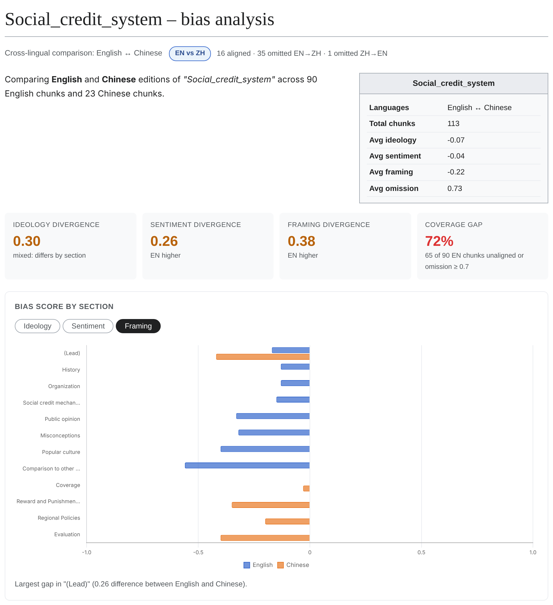
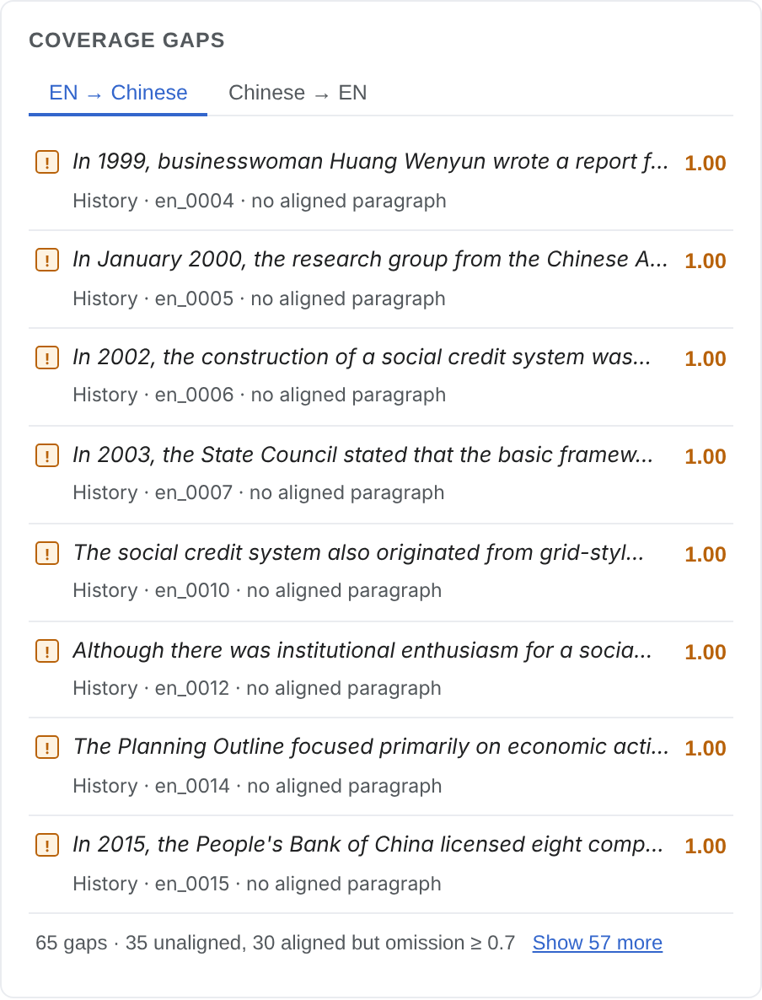
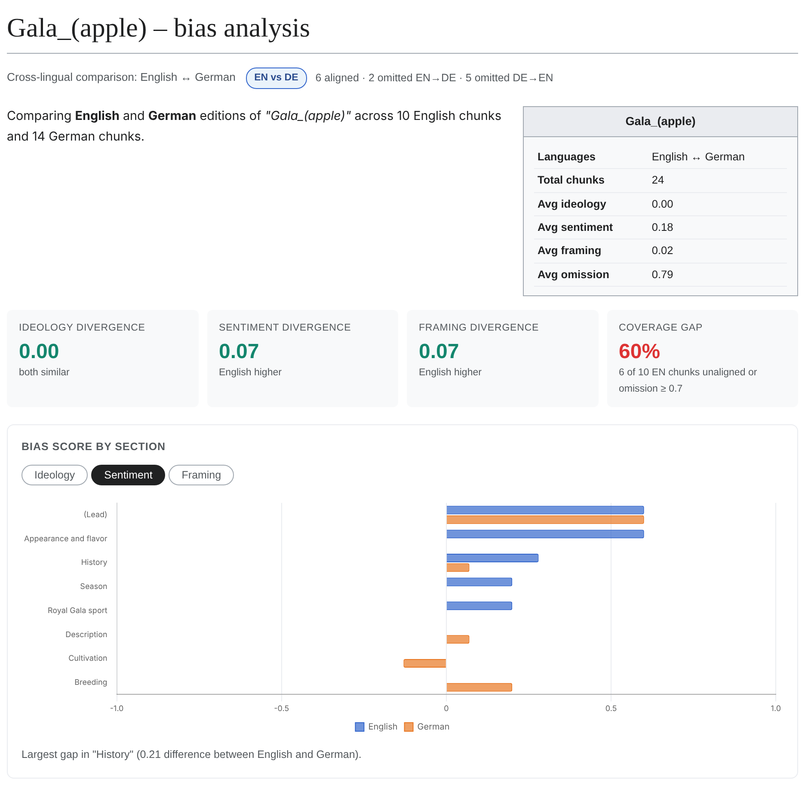

<h1 align="center">WikiLens</h1>

<p align="center"><em>Cross-lingual bias analysis for Wikipedia</em></p>

<p align="center">Built for the <strong>IBM watsonx GenAI Challenge 2025</strong>, then continued and rebuilt as a solo project.</p>

<p align="center">
  
  
  
  
  
</p>

<p align="center"><a href="README.zh.md">中文说明</a></p>

**Cross-lingual bias analysis for Wikipedia.** Compare the same article across two language editions, align the passages that describe the same facts, and see what each edition leaves out or frames differently.

<p align="center"></p>

## What it does

Given a Wikipedia title and a language pair (for example English and Chinese), WikiLens:

1. **Fetches** both editions via Wikidata sitelinks and splits them into paragraph-level chunks.
2. **Aligns** chunks across languages: LaBSE embeddings retrieve the top 10 candidates, then an LLM judges which candidates describe the same fact (`match` / `partial` / `none`).
3. **Scores** every chunk with an LLM on ideology, sentiment and framing (−1 to +1), and computes an **omission** score (0 to 1) from how much of the chunk is covered by its aligned counterparts.
4. **Shows** the result in a web UI: per-section bias charts, the most divergent chunks, and the coverage gaps in each direction.

The LLM backend is pluggable: IBM watsonx, any OpenAI-compatible API (OpenRouter, Groq, Together, OpenAI), or a local Ollama model. The reference configuration is Llama 3.3 70B.

## Why

Wikipedia editions are written by different communities and are not translations of each other. The same topic can get different facts, different emphasis and different sources in each language. WikiLens makes those differences visible at the paragraph level, so an editor can see *where* two editions diverge rather than only *that* they do.

<p align="center"></p>

## How well does the alignment work?

Everything downstream depends on alignment: an omission score is only meaningful if the aligned chunks really describe the same facts. So the alignment step was evaluated against human judgements.

**Setup.** I labelled 54 Chinese chunks from two articles (*Huawei*, *Social credit system*) against their English editions: for each chunk, which English chunks describe the same facts (match / partial / none), and whether the correct counterpart was missing from the candidate list entirely. Labels live in `eval/labels/`, the guidelines in `docs/annotation_guidelines.md`.

**Result.** On these 54 chunks (132 labelled candidate pairs):

| Alignment method | Precision | Recall | F1 |
|---|---|---|---|
| Chunk cosine, original thresholds (0.45 / 0.45) | 0.15 | 0.29 | 0.20 |
| Chunk cosine, tuned threshold (0.70) | 0.59 | 0.36 | 0.45 |
| Sentence-max cosine (0.65) | 0.61 | 0.43 | 0.50 |
| **Top-10 cosine + LLM rerank (default for en-zh)** | **0.62** | **0.69** | **0.65** |

The original pipeline aligned mostly wrong pairs: 85 % of its matches were not matches. Tuning the threshold helps, but a third of the true counterparts were not even in the top-3 cosine candidates, because a Chinese paragraph often covers several facts that the English edition spreads over several short paragraphs. Letting an LLM read the top 10 candidates recovers most of these. Full numbers and the grid search are in `docs/alignment_experiments.md`; `python -m wikilens experiment` reproduces them.

**Caveats.** 54 chunks from two articles, one annotator, one language pair; the 95 % CI on the F1 of the default method is about 0.54 to 0.75, and the best threshold differed between the two articles. The labels were collected on candidates proposed by the original method, which biases the evaluation towards it. The bias scores (ideology, sentiment, framing) have not been validated against human judgements yet.

## What it finds

A few things the labelled articles showed, as examples of what the tool surfaces:

- **Different emphasis, same company.** The Chinese *Huawei* article spends most of its length on the company's internal history: early switch sales, management culture, employee housing and the "mattress culture", subsidiaries. The English article spends it on the outside view: sanctions, security allegations, 5G bans. Both are long; they just cover different things.
- **Same source, opposite reading.** The Chinese *Social credit system* article cites a 2015 Dutch newspaper report as part of its criticism section. The English article cites the same report in its *Misconceptions* section, as the origin of a misunderstanding about a national citizen score.
- **Same facts, opposite framing.** Both editions state that Huawei's equipment is cheap and widely deployed. The Chinese edition presents this as a competitive advantage; one English passage presents it as the reason a security flaw would have wide reach.
- **Gaps in both directions.** Sweden's 5G ban on Huawei and the company's refusal to go public are in the Chinese edition only; the early policy history of the social credit system (1999 to 2007) is in the English edition only.
- **Plain drift.** Several dates differ by a year between editions, a Chinese section is a near-verbatim translation of the English one, and a late-2025 regulation appears only in Chinese because the English article has not been updated.

Note that the Chinese Wikipedia is edited by a community spanning mainland China, Taiwan, Hong Kong and overseas; differences reflect those editors, not any single official position.

<p align="center"></p>

## Setup

```bash
git clone https://github.com/anqiXu33/wikilens
cd wikilens
python3.12 -m venv .venv && source .venv/bin/activate
pip install -r requirements.txt
cp .env.example .env   # add an LLM backend, see below
```

Run an analysis, or just browse the saved runs without any key:

```bash
python -m wikilens run --title "Huawei" --pair en-zh      # full pipeline
python -m wikilens serve --offline                         # web UI on saved runs, no network, no key
python -m wikilens runs                                    # list saved runs
python -m wikilens replay RUN_ID                           # print a saved run
```

LaBSE weights are downloaded from Hugging Face on first use. Section titles are translated with the configured LLM (`TRANSLATION_BACKEND`, default `auto`).

### LLM backend (`.env`)

| `SCORING_BACKEND` | Needs | Notes |
|---|---|---|
| `openai` | `OPENAI_BASE_URL`, `OPENAI_API_KEY`, `OPENAI_MODEL` | OpenRouter, Groq, Together, OpenAI. Reference: `meta-llama/llama-3.3-70b-instruct` on OpenRouter |
| `ollama` | `OLLAMA_MODEL`, `OLLAMA_URL` | local model, no key; small models score noticeably differently from 70B |
| `watsonx` | `IBM_API_KEY`, `IBM_PROJECT_ID` | IBM watsonx.ai, the backend used in the original challenge |

An en-zh run makes about one LLM call per chunk per direction for alignment plus one per chunk for scoring; *Huawei* (133 + 112 chunks) costs a few cents on OpenRouter with Llama 3.3 70B. Without an LLM configured, alignment falls back to sentence-max cosine (F1 0.50).

## Project structure

```
app/services/      fetcher, chunker, embedder, aligner, scorer
app/pipeline.py    one end-to-end run
wikilens/          CLI: run, serve, runs, replay, annotate, evaluate, experiment
static/            web UI
eval/              human labels, evaluation output, alignment experiments
docs/              review, annotation guidelines, experiment notes, images
outputs/runs/      saved runs, each with its own meta.json and provenance
```

## Credits

WikiLens was built by a team of five for the **IBM watsonx GenAI Challenge 2025**. The team built the fetching, chunking, LaBSE alignment, watsonx scoring and web UI together; I was responsible for the methodology and the technical design.

After the challenge I continued the project on my own: a pluggable LLM backend, a bug-fix pass that corrected an inverted omission score and several alignment and chunking errors, a reproducible CLI with offline replay, the human-labelled alignment evaluation, and the LLM-reranked alignment that is now the default.

## License

MIT
